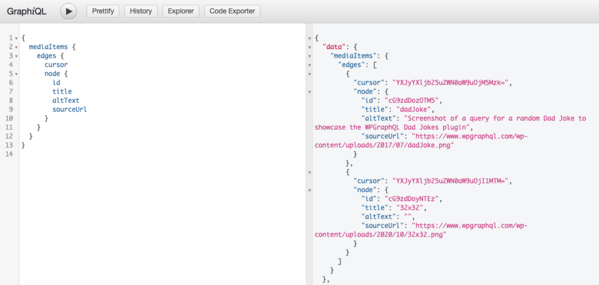
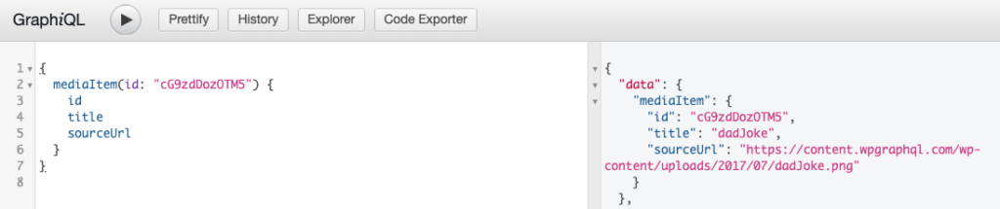
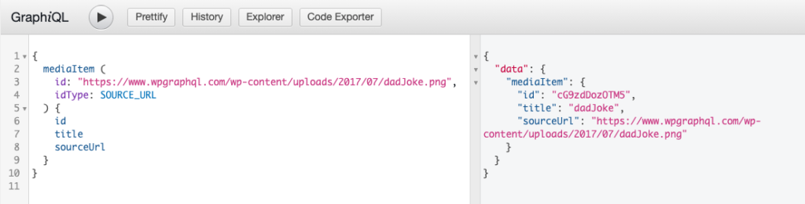
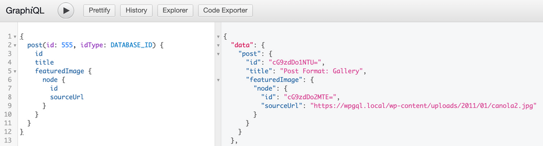

WPGraphQL provides support for querying Media Items, what WordPress calls "attachments".

This page will be most useful for users what are familiar with [GraphQL Concepts](/docs/intro-to-graphql/) and understand the basics of [writing GraphQL Queries](/docs/intro-to-graphql/#queries-and-mutation).

## Querying Media Items

WPGraphQL supports querying Media Items in various ways.

Below are some common examples of querying Media Items with WPGraphQL.

### List of Media Items

Below is an example of querying a list of media items.

```graphql
{
  mediaItems {
    edges {
      cursor
      node {
        id
        title
        altText
        sourceUrl
      }
    }
  }
}
```



### Single Media Item by Global ID

Below is an example of querying a Media Item using its Global ID.

```graphql
{
  mediaItem(id: "cG9zdDozOTM5") {
    id
    title
    sourceUrl
  }
}
```



### Single Media Item by Source Url

If you have the source url for an image in the media library, you can use that as a unique identifier for querying an Media Item.

```graphql
{
  mediaItem (
    id: "/static/9cb15e2b7fddc510b725924a6a491cb9/dadJoke.png", 
    idType: SOURCE_URL
  ) {
    id
    title
    sourceUrl
  }
}
```



### Query a post with it's featured image

Below is an example of querying a Post using its Database ID, and its connected Featured Image.

The connection between the Post and Featured image is a good example of a [one-to-one connection](/docs/connections/).

```graphql
{
  post(id: 555, idType: DATABASE_ID) {
    id
    title
    featuredImage {
      node {
        id
        sourceUrl
      }
    }
  }
}
```



### Comments on a Media Item

Below is an example of querying the comments of a Media Item.

```graphql
{
  mediaItem(id: 556, idType: DATABASE_ID) {
    id
    comments(first: 10) {
      nodes {
        id
        content
      }
    }
  }
}
```

A Media Item is visible when the content it's attached to is, and one that isn't attached to anything is visible to everyone. Its comments follow the same rule.

Comment lists that aren't limited to specific content, like the root `comments` list, leave comments on Media Items out for users who can't moderate comments, so query them by Media Item, as above, or with the `contentId` argument. See [Comment Visibility](/docs/comments/#comment-visibility).

## Mutating Media Items

**NOTE:** WPGraphQL supports mutations for the data stored in the Database for Media Items, but WPGraphQL does not (yet) provide a way to handle the actual uploads of files. [See open issues related to this topic](https://github.com/wp-graphql/wp-graphql/issues?q=is%3Aissue+is%3Aopen+upload+image).
